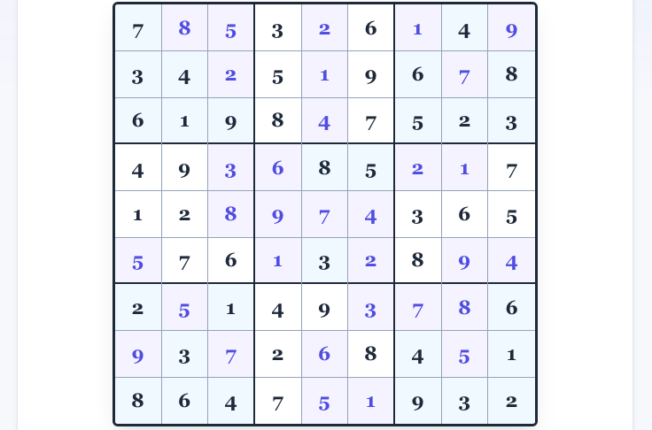

# Fall EECS 368 Assignment 4 - Lucas Frias

Welcome back and happy October. Today is one of the harder EECS assignments I've done, but I'm all the more excited. Today's prompt is Sudoku. Personally, I hate Sudoku. I think that it's not a useful puzzle because I don't realy reason in a geometric way and it's hard for me to think about. Thankfully, we now have computers to solve this problem. Today will be an interesting comparison between two new LLM models: Opus 5.5 on Medium reasoning (from Anthropic) and Google's Gemini 3.6 Flash.

As stated in the previous assignments, I was able to access Anthropic's models by creating a free account on their website. Then, in a normal chat window, I put the prompt I'll soon display below and located in PROMPT.md in the directory /prompt_rubric in this CWD you're reading this from. I'll be referring to this model as Opus for the remainder of the discussion.

On the other side, Gemini is new but about the same. Log in with your Google Account on the website, and then you are able to put in some sort of prompt into the prompt window. The default model (Gemini 3.6 Flash) is the one I used, and likewise I'll be referring to this as Flash (although there are many Flash models)


# Prompt

```
generate C++ code using objects, not functions, to implement
the following requirements (Note: You may use either ChatGPT or CoPilot as one
of your choices, but not both. They are essentially the same GenAI.):
• Sudoku is a number puzzle in which a 9x9 grid is subdivided into 9 3x3 sub-
grids, or blocks.
• A typical puzzle is shown here (image credit: Wikimedia Commons):
o
• Each of the cells in the puzzle must be filled in with a single digit 1-9, subject
to the following constraints:
o Each digit from 1 to 9 must appear exactly once in each row.
o Each digit from 1 to 9 must appear exactly once in each column.
o Each digit from 1 to 9 must appear exactly once in each block.
• Published puzzles are usually constructed to have a unique solution. This
requires that at least 17 cells be filled in (and may require more; depending on
the puzzle and which cells are empty, as many as 78 filled cells can be
required to guarantee uniqueness). In general, the number of cells that are
already filled in is not a particularly good indicator of how difficult a Sudoku
puzzle is to solve.
• The Sudoku problem, then, is this: Given a partially completed Sudoku
puzzle, find the (or at least a) solution; if no solution exists, prove that.
• It is possible to solve a Sudoku puzzle entirely through logic. For example, in
the above puzzle, consider the bottom right block, top right cell. Because of
other numbers in the same row, column, or grid, that number cannot be 1, 2, 3,
5, 6, 7, 8, or 9, and so must be 4. By proceeding in this fashion, using these
and more advanced deduction rules, it’s possible to gradually fill in the entire
grid.
• That is not the approach we’re going to use. Instead, we’re going to
implement a brute-force search, in which we exhaustively try possibilities
until we find a solution. This will be slower to run but is easier to solve. (And
by “slower to run,” we mean it'll finish in a few tenths of a second rather than
a few milliseconds.)
• Here’s the idea: Suppose we have a Sudoku puzzle of which k of the 81 cells
are unfilled. We identify an empty cell and deduce a list of candidates for
what might go into that cell. If there are no such values (all digits are
accounted for elsewhere in the same row, column, or grid), then we must have
made a mistake in filling in the k cells and return a no-solution-found result.
Otherwise, we try putting the first candidate value into the empty cell, and see
if we can find a solution with the k+1 cells filled (i.e. a recursive call). If we
get a no-solution-found to the first candidate, then we try the next, and so on,
until we either find a solution (k == 81) or determine that no solution exists
2. 3. 4. 5. 6. (all candidates report no solution, which again implies we took a wrong path
somewhere earlier).
• This approach, by the way, is called depth-first search with backtracking. For
each empty cell we make an attempt and see how far we can get with it. If we
fail to find a solution, we back up until we find something else to try, and so
on. If a solution exists, we are guaranteed to find it, because we exhaustively
try all possibilities.
• You are given five files (puzzle1.txt through puzzle5.txt), each containing a
Sudoku puzzle. Digits already filled in have been placed, and an underscore
character (_) is used to indicate a blank square.
• Write a recursive object-oriented program to find the solution to the five
puzzle files.
• The output for each solution, should include:
o The puzzle file name (e.g., puzzle1.txt)
o The puzzle from the file printed out.
o The solution to the puzzle printed out or if no solution is found, “No
solution found” printed out.
• The solution may not be unique; if there is more than one solution to the
puzzle, your program should print them all out.
• To help you debug your program, solution1.txt is a solution to puzzle1.txt.
```

Additionally, the files puzzle1.txt ... puzzle3.txt were given, as well as the solution.txt. I wanted to introduce less test cases but still give each AI equal footing. These were uploaded with the feature (Upload files...) integrated into both chatbot interfaces.

## Speed
I don't usually make any notes on the generation, but this is noteworthy. Opus spent about ~1:00 reasoning and then came out with its output. Gemini Flash took 3 seconds! I understand that the model is designed to generate quickly, but it blew me out of the water with its speed.

# Correctness
I suspect that this is a textbook problem, because both LLMs implemented the answer well and quickly. It should be noted that by default, based on the rubric both Flash and Opus attempt to access the current directory for files named puzzle1....5.txt in order to process inputs

## Simple Correctness
On a first run, the programs outputted nearly the same 

<table>
<tr><th>./anthropic</th><th>./google</th></tr>
<tr><td><pre>
Puzzle:
5 _ _ | _ _ _ | 1 7 _
1 _ 6 | 5 _ 9 | _ 4 _
4 7 2 | 1 _ 6 | _ _ _
------+-------+------
9 _ _ | _ _ _ | 5 _ _
_ 1 8 | _ 9 5 | 4 _ _
6 _ _ | 4 _ 2 | 3 8 9
------+-------+------
_ 4 _ | _ _ _ | 9 3 _
_ 9 _ | 7 _ 3 | _ 5 _
2 6 3 | 9 5 8 | 7 1 4
</pre></td><td><pre>
Initial Puzzle:
5 _ _ _ _ _ 1 7 _
1 _ 6 5 _ 9 _ 4 _
4 7 2 1 _ 6 _ _ _
9 _ _ _ _ _ 5 _ _
_ 1 8 _ 9 5 4 _ _
6 _ _ 4 _ 2 3 8 9
_ 4 _ _ _ _ 9 3 _
_ 9 _ 7 _ 3 _ 5 _
2 6 3 9 5 8 7 1 4
</pre></td></tr>
<tr><td><pre>
Solution:
5 3 9 | 8 2 4 | 1 7 6
1 8 6 | 5 7 9 | 2 4 3
4 7 2 | 1 3 6 | 8 9 5
------+-------+------
9 2 4 | 3 8 7 | 5 6 1
3 1 8 | 6 9 5 | 4 2 7
6 5 7 | 4 1 2 | 3 8 9
------+-------+------
7 4 5 | 2 6 1 | 9 3 8
8 9 1 | 7 4 3 | 6 5 2
2 6 3 | 9 5 8 | 7 1 4
</pre></td><td><pre>
Solution 1:
5 3 9 8 2 4 1 7 6
1 8 6 5 7 9 2 4 3
4 7 2 1 3 6 8 9 5
9 2 4 3 8 7 5 6 1
3 1 8 6 9 5 4 2 7
6 5 7 4 1 2 3 8 9
7 4 5 2 6 1 9 3 8
8 9 1 7 4 3 6 5 2
2 6 3 9 5 8 7 1 4
</pre></td></tr>
<tr><td></td><td><pre>
Solutions found: 1
</pre></td></tr>
</table>

## puzzle2.txt

<table>
<tr><th>./anthropic</th><th>./google</th></tr>
<tr><td><pre>
Puzzle:
5 3 _ | 8 _ 4 | _ 7 6
1 _ 6 | _ 7 9 | _ 4 3
_ 7 _ | _ 3 6 | _ _ 5
------+-------+------
9 2 4 | _ 8 _ | 5 6 _
3 _ 8 | 6 9 _ | 4 2 7
_ 5 _ | 4 1 2 | 3 _ _
------+-------+------
7 4 5 | _ 6 _ | 9 _ 8
8 _ 1 | 7 _ 3 | 6 5 2
_ 6 3 | 9 5 _ | 7 _ 4
</pre></td><td><pre>
Initial Puzzle:
5 3 _ 8 _ 4 _ 7 6
1 _ 6 _ 7 9 _ 4 3
_ 7 _ _ 3 6 _ _ 5
9 2 4 _ 8 _ 5 6 _
3 _ 8 6 9 _ 4 2 7
_ 5 _ 4 1 2 3 _ _
7 4 5 _ 6 _ 9 _ 8
8 _ 1 7 _ 3 6 5 2
_ 6 3 9 5 _ 7 _ 4
</pre></td></tr>
<tr><td><pre>
Solution:
5 3 9 | 8 2 4 | 1 7 6
1 8 6 | 5 7 9 | 2 4 3
4 7 2 | 1 3 6 | 8 9 5
------+-------+------
9 2 4 | 3 8 7 | 5 6 1
3 1 8 | 6 9 5 | 4 2 7
6 5 7 | 4 1 2 | 3 8 9
------+-------+------
7 4 5 | 2 6 1 | 9 3 8
8 9 1 | 7 4 3 | 6 5 2
2 6 3 | 9 5 8 | 7 1 4
</pre></td><td><pre>
Solution 1:
5 3 9 8 2 4 1 7 6
1 8 6 5 7 9 2 4 3
4 7 2 1 3 6 8 9 5
9 2 4 3 8 7 5 6 1
3 1 8 6 9 5 4 2 7
6 5 7 4 1 2 3 8 9
7 4 5 2 6 1 9 3 8
8 9 1 7 4 3 6 5 2
2 6 3 9 5 8 7 1 4
</pre></td></tr>
<tr><td></td><td><pre>
Solutions found: 1
</pre></td></tr>
</table>

## puzzle3.txt

<table>
<tr><th>./anthropic</th><th>./google</th></tr>
<tr><td><pre>
Puzzle:
7 _ _ | 3 _ 6 | _ 4 _
3 4 _ | 5 _ 9 | 6 _ 8
6 1 9 | 8 _ 7 | 5 2 3
------+-------+------
4 9 _ | _ 8 5 | _ _ 7
1 2 _ | _ _ _ | 3 6 5
_ 7 6 | _ 3 _ | 8 _ _
------+-------+------
2 _ 1 | 4 9 _ | _ _ 6
_ 3 _ | 2 _ 8 | 4 _ 1
8 6 4 | 7 _ _ | 9 3 2
</pre></td><td><pre>
Initial Puzzle:
7 _ _ 3 _ 6 _ 4 _
3 4 _ 5 _ 9 6 _ 8
6 1 9 8 _ 7 5 2 3
4 9 _ _ 8 5 _ _ 7
1 2 _ _ _ _ 3 6 5
_ 7 6 _ 3 _ 8 _ _
2 _ 1 4 9 _ _ _ 6
_ 3 _ 2 _ 8 4 _ 1
8 6 4 7 _ _ 9 3 2
</pre></td></tr>
<tr><td><pre>
Solution:
7 8 5 | 3 2 6 | 1 4 9
3 4 2 | 5 1 9 | 6 7 8
6 1 9 | 8 4 7 | 5 2 3
------+-------+------
4 9 3 | 6 8 5 | 2 1 7
1 2 8 | 9 7 4 | 3 6 5
5 7 6 | 1 3 2 | 8 9 4
------+-------+------
2 5 1 | 4 9 3 | 7 8 6
9 3 7 | 2 6 8 | 4 5 1
8 6 4 | 7 5 1 | 9 3 2
</pre></td><td><pre>
Solution 1:
7 8 5 3 2 6 1 4 9
3 4 2 5 1 9 6 7 8
6 1 9 8 4 7 5 2 3
4 9 3 6 8 5 2 1 7
1 2 8 9 7 4 3 6 5
5 7 6 1 3 2 8 9 4
2 5 1 4 9 3 7 8 6
9 3 7 2 6 8 4 5 1
8 6 4 7 5 1 9 3 2
</pre></td></tr>
<tr><td></td><td><pre>
Solutions found: 1
</pre></td></tr>
</table>

## puzzle4.txt

<table>
<tr><th>./anthropic</th><th>./google</th></tr>
<tr><td><pre>
Puzzle:
7 3 2 | _ 8 4 | 6 9 1
9 1 _ | 3 _ _ | 5 2 _
8 _ _ | 9 _ 2 | 7 3 4
------+-------+------
5 4 9 | _ _ _ | 8 6 3
1 _ _ | _ 3 _ | 2 _ 7
_ 2 3 | _ 4 8 | 9 1 _
------+-------+------
3 9 _ | 8 5 _ | 4 7 2
_ 7 _ | 4 _ 3 | _ _ 6
4 6 8 | _ 7 _ | _ 5 9
</pre></td><td><pre>
Initial Puzzle:
7 3 2 _ 8 4 6 9 1
9 1 _ 3 _ _ 5 2 _
8 _ _ 9 _ 2 7 3 4
5 4 9 _ _ _ 8 6 3
1 _ _ _ 3 _ 2 _ 7
_ 2 3 _ 4 8 9 1 _
3 9 _ 8 5 _ 4 7 2
_ 7 _ 4 _ 3 _ _ 6
4 6 8 _ 7 _ _ 5 9
</pre></td></tr>
<tr><td><pre>
No solution found
</pre></td><td><pre>
No solution found
</pre></td></tr>
</table>

## puzzle5.txt

<table>
<tr><th>./anthropic</th><th>./google</th></tr>
<tr><td><pre>
Puzzle:
_ _ _ | _ _ 4 | 2 _ 1
_ _ _ | _ 7 _ | _ _ 5
_ _ 8 | 1 _ 5 | 7 _ _
------+-------+------
_ 4 1 | _ 3 2 | 8 _ _
3 8 9 | _ 5 6 | 1 2 7
2 _ _ | _ _ 8 | 3 _ _
------+-------+------
_ 2 4 | _ _ 7 | _ 1 _
8 3 6 | _ 9 _ | 4 _ _
_ _ 7 | _ _ 3 | 5 _ _
</pre></td><td><pre>
Initial Puzzle:
_ _ _ _ _ 4 2 _ 1
_ _ _ _ 7 _ _ _ 5
_ _ 8 1 _ 5 7 _ _
_ 4 1 _ 3 2 8 _ _
3 8 9 _ 5 6 1 2 7
2 _ _ _ _ 8 3 _ _
_ 2 4 _ _ 7 _ 1 _
8 3 6 _ 9 _ 4 _ _
_ _ 7 _ _ 3 5 _ _
</pre></td></tr>
<tr><td><pre>
Solution 1 of 2:
7 5 3 | 6 8 4 | 2 9 1
4 1 2 | 3 7 9 | 6 8 5
9 6 8 | 1 2 5 | 7 3 4
------+-------+------
6 4 1 | 7 3 2 | 8 5 9
3 8 9 | 4 5 6 | 1 2 7
2 7 5 | 9 1 8 | 3 4 6
------+-------+------
5 2 4 | 8 6 7 | 9 1 3
8 3 6 | 5 9 1 | 4 7 2
1 9 7 | 2 4 3 | 5 6 8
</pre></td><td><pre>
Solution 1:
7 5 3 6 8 4 2 9 1
4 1 2 3 7 9 6 8 5
9 6 8 1 2 5 7 3 4
6 4 1 7 3 2 8 5 9
3 8 9 4 5 6 1 2 7
2 7 5 9 1 8 3 4 6
5 2 4 8 6 7 9 1 3
8 3 6 5 9 1 4 7 2
1 9 7 2 4 3 5 6 8
</pre></td></tr>
<tr><td><pre>
Solution 2 of 2:
7 5 3 | 8 6 4 | 2 9 1
4 1 2 | 3 7 9 | 6 8 5
9 6 8 | 1 2 5 | 7 3 4
------+-------+------
6 4 1 | 7 3 2 | 8 5 9
3 8 9 | 4 5 6 | 1 2 7
2 7 5 | 9 1 8 | 3 4 6
------+-------+------
5 2 4 | 6 8 7 | 9 1 3
8 3 6 | 5 9 1 | 4 7 2
1 9 7 | 2 4 3 | 5 6 8
</pre></td><td><pre>
Solution 2:
7 5 3 8 6 4 2 9 1
4 1 2 3 7 9 6 8 5
9 6 8 1 2 5 7 3 4
6 4 1 7 3 2 8 5 9
3 8 9 4 5 6 1 2 7
2 7 5 9 1 8 3 4 6
5 2 4 6 8 7 9 1 3
8 3 6 5 9 1 4 7 2
1 9 7 2 4 3 5 6 8
</pre></td></tr>
<tr><td></td><td><pre>
Solutions found: 2
</pre></td></tr>
</table>

> This table was generated by Opus 5.5, copied from my ouputs

As you can see, the outputs are nearly identitcal. I actually had to diff the files to make sure that I didn't copy the same executable twice. What Opus 5.5 did a minute, Flash did in a couple of seconds, generating the same outputs. I also went and tested this on a real Sudoku solver, which you can see the results of here for puzzle3

>Access the tool here https://anysudokusolver.com (retrived October 5th 4:00 PM)

<!--
Source - https://stackoverflow.com/a/41912122
Posted by Philipp Schwarz, modified by community. See post 'Timeline' for change history
Retrieved 2026-10-05, License - CC BY-SA 4.0
this was from me figuring out how to display an image in markdown lol
you're a real one if you're reading the bare markdown file
-->


> Problem 3, solved with an external tool


Both on the fact that every test input I checked was verified to be correct, and the LLMs have the same output too, I will say that these are, at least, functionally correct. 

## Bad Input
Incorrect input is a great test case, but Flash and Opus are both resilient, even though they do not operate on the principle of least suprise (that being, if there's something wrong or some sort of feature that should occur, defer to the expected result)

Both Flash and Opus will refuse to parse input files with more or less than the set number of lines. This itself is easy enough to check, but the added benefit is they allow for infinite whitespace (not newline, as that counts as a row with 0 elements). SO the input size is pretty liberal. 

I suspect, writing this before tearing down the code, that both just do a character regex removal for whitespace characters and then parse the file. What supports my hypothesis is how both files handle attempting to input a number higher than 1-9, which they will process as seperate numbers. Additionally, it detects non numeric characters and will specifically flag them as incorrect characters and stop execution of the program.

Generally, this is fairly robust. The only thing that is kind of bad is that number parsing because an invalid input file will appear valid (it will just cut off the excess numbers on the last row) so it appears to be a small execution flaw. Still has generally decent input handling for the program given, so I will give this good brownie points on this side too.


# Time Complexity

# Theoretical

In this one, I already have my work cut out for me. The prompts rubric given on Canvas specifically asks for a brute force implementation, with depth first search. This is really specific and the implementation that both follow, so we don't differ big here. First, we need to explain the process, which includes "greedy" solutions, branch trees, and the distribution of trees (explained to you by a sophomore CS student who is not all that good at algorithms).

## Brute Force

As alluded to, the prompt is specifically trying to find every solution not by any clever algorithm but by brute force. Our input size is 81 elements, but the amount of work we have to do is proporitional to the amount of empty squares. Let us denote N for this problem as 
```
n = spaces
```
where spaces are blank, unsolved squares from the input size. 

Let's take a simple 3x3 thing as an example:

```
-----------
| 1  _  3 |
| _  _  2 | 
| _  3 _ |
-----------

where n = 5 

and where the element range is 1 <= t <= 3
```

By solving this by brute force, we need to select every space and then follow every branch where we can insert an element. What does that mean?

Well, take the first row (1, _, 3). With this input, I cannot do 1 or 3 as a possible input. So I can denote that the A_ij (to use matrix notation, or in programming arr[i][j]) must be set to some value t (where t is bounded within my range) in one of my branches. We'll denote this change with

(A[i][j] = t) 

And we can represent series of these changes like so:

(A[i][j] = t) -> (A[m][n] = l)

Note that l is similarly bounded as t based on our Sudoku size

Notice that permutations of this algorithm can occur. We can say that

(A[i][j] = t) -> (A[m][n] = l)  == (A[m][n] = l) -> (A[i][j] = t)

as in these operations switched will result in the same board. This is true for any increasingly large input, and 
grows to the factorial, because for our N spaces, given there is some solution S, there are N! ways to represent that solution.

This is valid, and will let us produce the same solution. We don't ever implement any sort of algorithm to determine a check between branching because it would be difficult and not really worth it for Sudoku, but notice that we have to these extra calculations that confirm what we already know

Okay, now back to our practice Sudoku, let's say

A[0][1] = 2

```
-----------
| 1  2  3 |
| _  _  2 | 
| _  3  _ |
-----------
```

This branch is consistent. Consistency for our Sudoku will assume that our value t set at A[i][j] is such that for all i and j in range of A, where i != t's i and j != j's i, there does not exist a value such that our value == t. This is true in this case. This means this is a valid branch, and by calculating our potentially valid moves here (3 on 1,0 for example) we can go deeper and determine whether we have any solutions. We calculate deeper until we either have no valid moves, or we go back up. 

Because we iterately want to check every element for each possibility, assume that all possible ranges are valid. That is, 1, 2, 3 in our example range for t are valid for some row. Let M denote the max of our range. Therefore, this means that if all branches must be fully calculated out, for one part, it becomes
```
O(M^N)
where N is our space input size
and M is the range of our values
```

To use the more specific for our problem, we can say that the WCE would then be

```
O(9^N)
where N is our space input size
and max of t where 0 <= t  <= 9 == 9
```

The problem with determining this is there is a psuedo random real factor of what possibilities we can represent as we go down in the depth. There is likely not a scenario where this worst case will ever occur because of the shrinking of inputs and problems. Still, this is a bad time complexity to have. For our input size and spacing though, it's fine. Worst case scenario, assume that we have a fully blank Sudoku board and wish to calculate all permutations. This would be

O(9^81) = 196627050475552913618075908526912116283103450944214766927315415537966391196809

which is very large. I ran this on my Mac for about ten minutes and did not get a solution, but there would also be this many solutions to calculate.

# Actual

Previously, with for example the maxheap, it was the best metric to test really crazy input sizes (where nodes is n, n=500000 for example) and see how the implementation handled it. This really isn't useful here because of the law of averages (some Sudokus take more or less time than others). We can do this with a large number of inputs, but generating solvable Sudoku boards at a large scale is a programming assignment in of itself. Instead, let's measure it's general time complexity by creating boards with one less element. I prompted this to Opus, and it generated this Python code,
like before, to measure my time complexity.

Here's the prompt:

```
make a python file that compares the real system time used between ./anthropic and ./google by changing an input file question5.txt (a sudoku problem) by adding one more unknown. start from a fully solved board and remove a random element, and keep going until a cutoff of 30 seconds for time used. Here's your example board:
5 3 9 8 2 4 1 7 6 
1 8 6 5 7 9 2 4 3 
4 7 2 1 3 6 8 9 5 
9 2 4 3 8 7 5 6 1 
3 1 8 6 9 5 4 2 7 
6 5 7 4 1 2 3 8 9 
7 4 5 2 6 1 9 3 8 
8 9 1 7 4 3 6 5 2 
2 6 3 9 5 8 7 1 4 
and be sure to denote the unknown as a character _ (for example)
5 3 9 8 2 4 1 7 6 
1 8 6 5 7 9 2 4 3 
4 7 2 1 3 6 8 9 5 
9 2 4 _ 8 7 5 6 1 
3 1 8 6 9 5 4 2 7 
6 5 7 4 1 2 3 8 9 
7 4 5 2 6 1 9 3 8 
8 9 1 7 4 3 6 5 2 
2 6 3 9 5 8 7 1 4 
where now 3 is _
```

It generated a Python file called compare_times.py, located in tooling.

```python
#!/usr/bin/env python3
"""Compare wall-clock time of ./anthropic and ./google as a Sudoku gets harder.

Starts from a fully solved board, blanks one more random cell each round,
writes the board to the puzzle file, and times both solvers on it. A solver
is dropped once it passes the cutoff; the run ends when both have.

Both binaries are run with no arguments from their own directory, so each
run solves puzzle1.txt .. puzzle5.txt; only puzzle5.txt changes, and round 0
(no unknowns) gives the fixed baseline cost of the other four puzzles.
"""

import argparse
import csv
import random
import subprocess
import time
from pathlib import Path

SOLVED = """\
5 3 9 8 2 4 1 7 6
1 8 6 5 7 9 2 4 3
4 7 2 1 3 6 8 9 5
9 2 4 3 8 7 5 6 1
3 1 8 6 9 5 4 2 7
6 5 7 4 1 2 3 8 9
7 4 5 2 6 1 9 3 8
8 9 1 7 4 3 6 5 2
2 6 3 9 5 8 7 1 4
"""

SOLVERS = ["anthropic", "google"]
UNKNOWN = "_"
ROOT = Path(__file__).resolve().parent.parent


def write_board(path, board):
    path.write_text("".join(" ".join(row) + " \n" for row in board))


def time_solver(exe, cwd, cutoff):
    """Return elapsed real seconds, or None if the solver passed the cutoff."""
    start = time.perf_counter()
    try:
        subprocess.run([str(exe)], cwd=cwd, stdout=subprocess.DEVNULL,
                       stderr=subprocess.DEVNULL, timeout=cutoff)
    except subprocess.TimeoutExpired:
        return None
    return time.perf_counter() - start


def main():
    parser = argparse.ArgumentParser(description=__doc__.splitlines()[0])
    parser.add_argument("--dir", type=Path, default=ROOT / "exec" / "mac_x86",
                        help="directory holding the two binaries and the puzzle file")
    parser.add_argument("--puzzle", default="puzzle5.txt",
                        help="puzzle file (inside --dir) to overwrite each round")
    parser.add_argument("--cutoff", type=float, default=30.0,
                        help="seconds before a solver is stopped and dropped")
    parser.add_argument("--seed", type=int, default=None,
                        help="random seed, for a repeatable removal order")
    parser.add_argument("--csv", type=Path, default=Path(__file__).with_name("times.csv"),
                        help="where to save the results")
    args = parser.parse_args()

    seed = args.seed if args.seed is not None else random.randrange(2**32)
    rng = random.Random(seed)
    print(f"seed {seed}, cutoff {args.cutoff:g}s, puzzle {args.dir / args.puzzle}")

    board = [line.split() for line in SOLVED.splitlines()]
    cells = [(r, c) for r in range(9) for c in range(9)]
    rng.shuffle(cells)

    puzzle = args.dir / args.puzzle
    original = puzzle.read_bytes() if puzzle.exists() else None
    active = list(SOLVERS)
    rows = []

    print(f"{'unknowns':>8}  " + "  ".join(f"{s:>12}" for s in SOLVERS))
    try:
        for unknowns in range(len(cells) + 1):
            if unknowns:
                r, c = cells[unknowns - 1]
                board[r][c] = UNKNOWN
            write_board(puzzle, board)

            row = {"unknowns": unknowns}
            for solver in SOLVERS:
                if solver not in active:
                    row[solver] = ""
                    continue
                elapsed = time_solver(args.dir / solver, args.dir, args.cutoff)
                if elapsed is None:
                    active.remove(solver)
                    row[solver] = f">{args.cutoff:g}"
                else:
                    row[solver] = f"{elapsed:.4f}"
            rows.append(row)
            print(f"{unknowns:>8}  " + "  ".join(f"{row[s] or '-':>12}" for s in SOLVERS),
                  flush=True)

            if not active:
                break
    finally:
        # Put the real puzzle back so the binaries behave normally afterwards.
        if original is not None:
            puzzle.write_bytes(original)
        else:
            puzzle.unlink(missing_ok=True)
        with args.csv.open("w", newline="") as f:
            writer = csv.DictWriter(f, fieldnames=["unknowns"] + SOLVERS)
            writer.writeheader()
            writer.writerows(rows)
        print(f"saved {args.csv}")


if __name__ == "__main__":
    main()
```
Here we can measure the actual time complexity of every program for each input. I would encourage you to do it (you'll have to change the path to an executable on your machine) because it's very entertaining
```
unknowns     anthropic        google
       0        0.1267        0.1324
       1        0.1302        0.1259
       2        0.1326        0.1338
       3        0.1274        0.1218
       4        0.1267        0.1321
       5        0.0788        0.1344
       6        0.1300        0.1275
       7        0.1320        0.1302
       8        0.1273        0.1320
       9        0.0795        0.1776
      10        0.0773        0.1268
      11        0.1283        0.1380
      12        0.1347        0.1212
      13        0.0759        0.1251
      14        0.1320        0.1129
      15        0.1451        0.1226
      16        0.0788        0.1251
      17        0.1463        0.1314
      18        0.1282        0.1011
      19        0.1209        0.1837
      20        0.1336        0.1374
      21        0.1267        0.1739
      22        0.1269        0.1826
      23        0.1337        0.1445
      24        0.1308        0.1759
      25        0.1310        0.1395
      26        0.1256        0.1784
      27        0.0787        0.1265
      28        0.1780        0.1772
      29        0.1281        0.1487
      30        0.1289        0.1806
      31        0.1224        0.1276
      32        0.1495        0.1311
      33        0.1417        0.1988
      34        0.1285        0.1364
      35        0.1295        0.1348
      36        0.1294        0.1288
      37        0.0777        0.2335
      38        0.1355        0.1581
      39        0.1816        0.0773
      40        0.1753        0.1261
      41        0.1813        0.0756
      42        0.1742        0.1261
      43        0.1270        0.1301
      44        0.1272        0.1222
      45        0.1718        0.1311
      46        0.1408        0.1272
      47        0.1331        0.1438
      48        0.1437        0.1464
      49        0.1976        0.1248
      50        0.1278        0.1259
      51        0.1762        0.1735
      52        0.1275        0.1831
      53        0.2430        0.2744
      54        0.3018        0.1789
      55        0.4453        0.2414
      56        0.8361        0.3339
      57        1.7608        1.0022
      58        7.3584        4.1716
      59        7.4029        4.0585
      60           >30       23.4342
      61             -            >30
```
with Gemini just shaving an extra 61 permutations before elapsing past.

This, when turned into a function, essentially turns into an exponential function. This matches our time complexity of 9^n fairly well, and we can see that this naive solution can't be save by Moore's law. 

So we can clearly see that this is a bad time complexity, but also under the constraints of the prompt implemented well. And for sufficiently normal solution sudoko this doesn't matter.

# Space Complexity

# Theoretical 
Theoretically, we have a space complexity of O(1) for all input sizes. This is because we don't actually store anything except for a contant linear board that just changes it's elements. There's no way that the space complexity changes any more than the initial variables and sudoku size (which is fixed at 9x9). However, what is more interesting is the amount of stacks consumed during execution.

As we know, the "stack" (as a theoretical concept) are all the variables being held in the current frame of code being executed. Essentially, the crux is that variables are stored within the stack exist only as long as that stack is "within scope". Stack variables are either stored in registers or the L1 cache. However, the amount that they change is significant, because it is expensive to switch to a new frame. This is why recursion usually has such bad latency problems, not because the concept is wrong but because of the switcthing to a new stack.

If we do a depth first search, worst case execution time means that for every input, we have to check our N number of squaresand then we proceed to go down for the input size. This means that our theoretical worse space complexity is O(n). This grows for every single new space we have, and logically follows.


# Actual

I modifed the Python script and made it so it measures ./time's space on stack frames so we can see how this scales.

```
unknowns  anthropic_sec  anthropic_rss_kb    google_sec  google_rss_kb
       0        0.0052          1728        0.0042          1712
       1        0.0038          1744        0.0042          1712
       2        0.0040          1728        0.0035          1712
       3        0.0041          1744        0.0035          1712
       4        0.0037          1728        0.0035          1712
       5        0.0037          1728        0.0035          1712
       6        0.0037          1744        0.0035          1712
       7        0.0037          1744        0.0046          1712
       8        0.0039          1744        0.0034          1712
       9        0.0037          1728        0.0035          1712
      10        0.0037          1744        0.0035          1712
      11        0.0038          1728        0.0039          1712
      12        0.0039          1744        0.0037          1712
      13        0.0038          1728        0.0035          1712
      14        0.0037          1728        0.0034          1712
      15        0.0037          1744        0.0043          1712
      16        0.0037          1728        0.0034          1712
      17        0.0037          1744        0.0034          1712
      18        0.0036          1744        0.0035          1712
      19        0.0036          1744        0.0042          1712
      20        0.0037          1744        0.0034          1712
      21        0.0037          1728        0.0034          1712
      22        0.0039          1744        0.0035          1712
      23        0.0043          1744        0.0036          1712
      24        0.0039          1728        0.0039          1712
      25        0.0037          1728        0.0036          1712
      26        0.0039          1744        0.0034          1712
      27        0.0037          1728        0.0041          1712
      28        0.0038          1744        0.0035          1712
      29        0.0037          1744        0.0035          1712
      30        0.0037          1728        0.0035          1712
      31        0.0036          1744        0.0042          1712
      32        0.0037          1728        0.0037          1712
      33        0.0038          1728        0.0035          1712
      34        0.0037          1728        0.0034          1712
      35        0.0036          1728        0.0042          1696
      36        0.0038          1728        0.0034          1712
      37        0.0037          1728        0.0034          1712
      38        0.0037          1728        0.0034          1712
      39        0.0037          1728        0.0043          1712
      40        0.0039          1744        0.0035          1712
      41        0.0040          1744        0.0035          1712
      42        0.0038          1728        0.0036          1712
      43        0.0039          1728        0.0042          1712
      44        0.0040          1728        0.0036          1712
      45        0.0039          1744        0.0035          1712
      46        0.0039          1744        0.0035          1712
      47        0.0045          1744        0.0047          1712
      48        0.0078          1792        0.0051          1712
      49        0.0078          1792        0.0051          1712
      50        0.0088          1792        0.0057          1712
      51        0.0101          1792        0.0059          1712
      52        0.0165          1840        0.0092          1712
      53        0.0170          1840        0.0085          1712
      54        0.0547          1872        0.0226          1728
      55        0.0730          1904        0.0297          1728
      56        0.1876          2128        0.0723          1760
      57        0.2133          2176        0.0824          1760
      58        0.2429          2400        0.1024          1760
      59        2.8778          4368        0.8113          1760
      60        7.0679         14976        3.3805          1760
```

Even though there is a theoretical time complexity of O(n), the actual machine time complexity is a lot more different between both implementations. On one end, we see that for larger spaces, there ends up becoming a huge e^n blowup. On the opposite side, there is a nearly constant time that changes very little for Google's space complexity, sticking to O(1). What's happening?

Well, it's a fundemental difference between output. While Opus saves every single solution on a heap allocated vector


```cpp

	if (!board.findEmptyCell(row, col)) {
            solutions.push_back(board);
            return;
        }

```

and then displays them afterwards, Flash just prints a canidate once it finds a solution

```cpp
	
	if (solutionsFound == 0) {
            std::cout << "\nNo solution found\n";
        } else {
            std::cout << "\nSolutions found: " << solutionsFound << "\n";
        }
       		 std::cout << "========================================\n\n";
    	}
```

Flash's sneaky optimization doesn't matter up until we achieve large N, which is why it differes. Other than that, the general linear time I attribute to the difference in space complexity for stack frames being so insignificant except for large inputs that force its scaling.


# Maintainability

Lots to discuss here, but I preface first with while I have learned a lot more about C++, all of that learning has been exclusively in this class and I am not a huge C++ enjoyer. That being said, I feel like I can confidently say there were some bad choices made.

## Uniqueness/Analysis

Before we talk about this, we have to talk about the eternal problem that comes from LLMs: code uniqueness. 

As you know, LLMs are trained on a large, billion parameter data set. This is particularly true for programming. The internet has the largest access to source code imaginable, and LLMs have used all of that data.

While Flash's implementation is a fantastic one, it feels weirld human. Having seen so much LLM output in my time here at KU, I can say that Flash's code doesn't seem to have just orginated from the model thinking through a solution but the model already having read a solution to this type of problem. 

I haven't been able to find any source code that contributes to this, nor was I expecting too. This is probably a deep recess of solutions from the model's catalogue. But I do want to make the note here, because I feel like as a whole Flash's code is either so perfectly generated that I cannot tell that it is AI generated, or that Flash's code is copied (not verbatim) from a well-mannered developer's output. Either way, I can find very little to critique Flash on its output.

## Bad Variable Names and Namsespace Collision

Super non-descript variable names are super confusing, and while yes,
I get that ch is the iterator character, calling it something other than its type:

```cpp
	//opus in loadFrom File
        char ch;
```

would be a lot better.

There are also some readability quirks that, in a large C++ codebase, would probably go thanked. For example, the constant usage of std::vector<int> might possibly be supplemented with a very explicitedly typed typedef (although there is a discussion to be had about namespace collision in such a codebase). 

To elaborate more on this topic specifically, I think namespace collision is a really hard and difficult problem. In C++, if your namespace is the same as some library/header/script file you link or include as a prerequisite, the compilier will favor different declarations and cause extremely tedious problems. To counteract this, it is recommended to use the explicit std::type as there will be no possible way to annotate against this and will cause little collision. This can lead to be a problem though, especially when we consider C++ that strings multiple types together. 

I would say that for some types (std::string, for example) not only does this type annotation make sense but diagetically it helps read the code make sense as a specific C++ implementation. I really would like to know whether or not I'm using a std::unique_ptr versus a std::shared_ptr, for example. But I think some types are so absolutely fundemental to C++ that explicitly doing std:: is ridiculous. For example, the std::size_t 

```cpp
//anthropic, runOne function
    std::size_t count = solver.solve();
        if (count == 0) {
            out << "No solution found\n";
            return;
        }
```

seems *too* explicit, and not usefully so. This is "modern" C implemented into C99 (https://stackoverflow.com/questions/2550774/what-is-size-t-in-c) so there really should be no reason to have to explicitly to std::size_t but not int, or float. 

According to this post here, it's even common and possible (at least in C++11) (https://stackoverflow.com/questions/36594569/which-header-should-i-include-for-size-t) to be able to include namespaces in a global scope. I think not doing it shows how LLMs generally tend to write forcefully safe but alien code.

## inline Statements and My Disagreement with the C++ Standard

This is not the first time I have felt this way, but let us specifically dwelve into one of many shards that Blarne Stroussup has left for developers: inline

Because function calls usually compile code that jumps to a label, sets up a new stack, and executes code, sometimes this behavior is not useful. In fact, sometimes you have a oneline function that calculates something easily that you may want to reuse throughout functions. This is why we do inline functions in C.

In C, if you explicitly annotate a function such as:

```c
	inline int foo(int a){
		return a + 1;
	}

	int main(){
		int number = 7;
		return foo(number);
	}
```
then the function will, instead of compiling jump to its own frame, will generated that code within the space where the function is called

```
	;some theoretical psuedo isa that looks
	;like x86 
	mov eax, 7
	add eax, 1
	ret eax
```

Instead of doing

```
	foo:
		push eax ;push eax
		add eax, 1
		goto ra
	main:	
		mov eax, 7
		push ra ;push return address
		ret eax	
```

which is considerably more complex. So, C++ being a superset of C, one would expect this literal behavior to translate over. When I saw

```cpp
   //opus, SudokuBoard function declaration 
    int get(int row, int col) const { return cells[row][col]; }
    void set(int row, int col, int value) { cells[row][col] = value; }
    void clear(int row, int col) { cells[row][col] = EMPTY; }
``` 
I thought to myself, as a C programmer, that this really ought to be an inline function. However, when looking on whether inline methods exist for classes, I found this explanation by Mr. Poluektov

https://stackoverflow.com/questions/9370493/inline-function-members-inside-a-class

> Both syntaxes for inlining functions (using explicit inline and defining member-function inside class definition) provides only hint about inlining for compiler. From performance point of view, they are equal.

This seemed confusing to me. These shouldn't literally be the same. But also, this was an older post. Maybe such a thing has changed.

Looking at the official C++ documentation made my day a lot worse. Here it says

> The original intent of the inline keyword was to serve as an indicator to the optimizer that inline substitution of a function is preferred over function call, that is, instead of executing the function call CPU instruction to transfer control to the function body, a copy of the function body is executed without generating the call. This avoids overhead created by the function call (passing the arguments and retrieving the result) but it may result in a larger executable as the code for the function has to be repeated multiple times.

It then goes on to say

> Since inline substitution is unobservable in the standard semantics, compilers are free to use inline substitution for any function that's not marked inline, and are free to generate function calls to any function marked inline. Those optimization choices do not change the rules regarding multiple definitions and shared statics listed above.

Even though C++ claims to be a "C superset" it deprecates one of the few keywords that the original C even has and removes one of its major optimizations, making it turn into a compilier specific nightmare.

To give C++ a smidge of credit, it is the case that inline is also compilier specific in the original C. But also, that while the way that implementation is presented will turn it into inline code inserted. So to completely deprecate this feature seems so bizarre.

This is the latest C++17 standard, which of course means that it will take another five years to be widely adopted. But I feel that, baed on the StackOverflow post, C++ will still do this and just apply optimizations where it sees fit with no regard to actual C.

I cannot blame the AI for the sins of C++, however. Let's move on

## Suffix vs Prefix Incremenetation

I don't know if this is an explicit style guide given to the models because of past mistakes, but in many places, all of the models will insist on doing suffix incrementation such as:

```cpp
	//on printGrid, google flash
        for (int r = 0; r < SIZE; ++r) {
```

The reason for this, as discussed last time, is because the value does not need to be used, so it is discarded. That is, in C the increment operator evaluates to a value, as do most assignments, but by doing ++r it will evaluate the expression as r+1 instead of evaluating as simply r with the suffix incrementation r++.

There's no reason to really implement this in for loops. In C, this is a compilier specific feature (as I discovered on a problem) but in C++ this is actually a standard feature implemented in the C++ standard.
According to Mr. VanderLinde:

*https://stackoverflow.com/questions/7031326/what-is-the-difference-between-prefix-and-postfix-operators*

> In the prefix version (i.e., ++i), the value of i is incremented, and the value of the expression is the new value of i.

He goes on to say
> In the postfix version (i.e., i++), the value of i is incremented, but the value of the expression is the original value of i.

So as we can see, this behavior holds consistently. But the values in for loops are thrown away. I feel like this was an incentive given to reduce off by one C++ tricks being implemented to these models, but enforcing this on for loops seems strange. I cannot, for the life of me, find a C++ codebase that does this. I'm a novice to this language, but it is more expected to use the suffix (or postfix, as Mr. VanderLinde says) within for loops.


## Weird Class Organization

Class organization in C++ matters a lot, because it's a pretty fundemental reason to choose C++ over C. Upon further reflection, there are some fundemental problems where I disagree with how a class should be implemented. Maybe I am human, and I don't understand how object oriented programming should really be thrown together.

*Supporting evidence: https://stackoverflow.com/questions/3541399/postfix-and-prefix-increment-operator-in-a-for-loop*

A great place to start is with the first class, first method, and the idea behind it. In both Opus and Flash, we create a SudokuBoard class to interface with. But in our constructor, all we do is set our entire array empty, in both of our LLM outputs


```cpp
//google's sudoku solver
public:
    SudokuSolver(const std::string& file) : filename(file), solutionsFound(0) {
        for (int r = 0; r < SIZE; ++r) {
            for (int c = 0; c < SIZE; ++c) {
                grid[r][c] = 0;
            }
        }
    }

    // Reads the grid from the file
    bool loadPuzzle() {
        std::ifstream file(filename);
        if (!file.is_open()) {
            std::cerr << "Error: Could not open file " << filename << std::endl;
            return false;
        }
```

Opus' output is pretty much the same. Even though we initialise the object with our constructor, it contains no useful data until we actually load data from our file. We have to do a seperate loadPuzzle call.

I've been trying to find a decent reason to split up this behavior, and I can only really find one good reason, which is that the constructor ought to always be error free. Initialises our array will always be a successful operation, but loading our files will not.

```cpp
    //from google's main function
    for (const auto& filename : puzzleFiles) {
        SudokuSolver solver(filename);
        if (solver.loadPuzzle()) {//check the boolean value,
	//and discard the eval if we can't load it
            solver.solve();
        }
    }
```

However, it leads to maybe a philisophical disagreement with *how* classes should work: that when a class is initalised, it has the data passed into it initially. To use Python as an example:

```python
	class Dog:
		def __init__(self, age, canBark, type):
			self.type = type
			self.age = age
			self.canBark = canBark
```
This makes sense as we initialise all the members **with the data that we need to interface later**. However, imagine a dog class where
```python
	class Dog:
		def __init__(self, canBark, type):
			self.type = type
			self.age = 0
			self.canBark = canBark
		def validate_age_range(self, age):
			if age > 0 and age < 15:
				self.age = age
				return True
			return False
```

This seems pretty strange. Not the level of trust. In our first example, we could have users pass bad data and interface with our class incorrectly. But the question is this: if the constructor and interface are completely controlled by us, why not do sepearte input validation before creating the object, and then loading the constructor? 

This might seem nitpicky, but I genuinely assure that there is a reason for this difference. In one instance, when we don't do input validation until after the constructor, we create and discard empty Sudoku boards. But if we check that our input file is good before loading it in, we lower the hurdle of having to interface through a method and continous calling to empty class objects.

There is also a possible argument for having the checker in the constructor, such that the file name is passed as a string and then if the file fails, we throw an exception. But exception based promgramming is not generally good practice unless handled really well, and I would stear clear of that if possible.

All of this to say, I would like to fix it so that the input validation is handled by not checking in an empty instance of the board that we throw away, but in a seperate function, to reduce waste and keep the object oriented paradigm clean. A constructor ought to prepare a class completely, and not load it with dummy data. 

There's also some other bad practices. For example, in the private implemtantation of SudokuSolver, in Opus' output:

```cpp
private:
    // Fills one empty cell and recurses on the rest. When no empty cell
    // remains (k == 81) the board is a solution. Returning from this call
    // with the cell cleared is the backtrack step.
    void search() {
        int row, col;
        if (!board.findEmptyCell(row, col)) {
            solutions.push_back(board);
            return;
        }

        // An empty candidate list means an earlier guess was wrong; the loop
        // body never runs and we fall straight back to the caller.
        std::vector<int> options = board.candidates(row, col);
        for (std::size_t i = 0; i < options.size(); ++i) {
            board.set(row, col, options[i]);
            search();
            board.clear(row, col);
        }
    }

    //NOTICE THIS HERE
    SudokuBoard board;
    std::vector<SudokuBoard> solutions;
};
```

Somehow, we implement the variables for the private implementation after our functions. This is bad, and not from a functionality standpoint. The closest thing I can find online discussing this in a diagetic, non-technical way is this paper here:

https://fpga.org/wp-content/uploads/2023/11/MS-C-Under-the-Hood.pdf 

Essentially, what C++ does is it treats classes like structs (which is pretty much just a organized data "blob") and then gives functions varying degrees of access to those methods in a completely seperate block. This allows us, to, in theory, move the order of variables and functions in any order, as it doesn't matter for the declaration.

In **practice** though, not only is this ridiculously confusing, it also provides no actual useful syntactial reason. Unlike before, where there is a shaky but understandable convention to always use ++i iterators with a suffix when the value can be cast, there is no optimization or preformance reason I can find for adding member variables to the end. I think this behavior is only the result of bad LLM quality in writing human-readable consistent code. Consistency matters too. Other member variables in different classes in the same codebase are declared elsewhere.

```cpp

//very first line of actual code
//in anthropic
class SudokuBoard {
public:
    static const int SIZE = 9;
    static const int BLOCK = 3;
    static const int EMPTY = 0;
```

It's strange hiccups like this that make LLM output so non-deterministic and surreal sometimes, plausible code and diagnostics that kind of get paper mached into a different response. 

# Human Fixes

When reviewing both of these codebases, I was shocked at how quick Flash's response was, and I assumed that because and for this reason, it would have a strong decrease in accuracy. On the opposite, not only do I feel like the code is well intentioned and thought out, I cannot find any significant errors (only smaller stylistic changes which I will soon list below. Therefore, I've decided to implement Flash's solution. Again, I feel as if it cannot purely be an LLM's unadultered output, but a specific repetition of this exact problem, maybe from its training set, with a human solution that increased the exact solution. In fact, Google is known to program a lot of models to solve games (such as Chess and Go (not the language, but board game)) so it would not suprise me that this is something that they would be able to base internally. But guessing on weights aside, Flash is vastly superior in both code and metrics. For the first time since Assignment 2, Anthropic has been dethroned.

Here are the changed implementations:
```cpp
/*
	<@
	(KU/
	 "
human.cpp - by google gemini flash
modified slightly by lucas frias
 Program:       human.cpp
 Description:  Solves Sudoku problems using a naive approach 
 Input:         N/A (assumes local files) 
 Output:        All puzzles.txt and their solutions (if possible)
 Collaborators:  Google Gemini Flash, Lucas Frias
 * Author:        Lucas Frias (by using Gemini Flash)
 * Created:       October 13th 2026 
 * Revised:        2026-10-13, implemented fix features 
 *                category to enum class Category, per Opus 5.5 pairing
 * Build:         g++ human.cpp -std=c++11 -Wall -Wextra -o ./human
 * Run:           ./human (ensure you have puzzles1.txt, puzzles2.txt, all the way to five
*/
#include <iostream>
#include <fstream>
#include <vector>
#include <string>

class SudokuSolver {
//sudoku solver, our main class to solve sudoku

private:
    //make a private class with a size, blcok_size
    static const int SIZE = 9;
    static const int BLOCK_SIZE = 3;
    //make a grid with our set size (always a square)
    int grid[SIZE][SIZE];
    //make a filename
    std::string filename;
    //make a counter for the solutions found
    //lucas edit, the solutionsFound should be zero
    //initialised when declared
    int solutionsFound = 0;

    // Checks if placing 'num' at grid[row][col] is valid

    bool isValid(int row, int col, int num) const {
	//changes - added suffix increment
	
        for (int i = 0; i < SIZE; i++) {
            // Check row and column
		//here we check whether or not the number reappears
            if (grid[row][i] == num || grid[i][col] == num) {
                return false;//if it does return false
            }
        }

        // Check 3x3 block
	
	//changes - use human variable names row and col 
	//instead of r and c, and use correct suffix incrementing

        int startRow = (row / BLOCK_SIZE) * BLOCK_SIZE;
        int startCol = (col / BLOCK_SIZE) * BLOCK_SIZE;
        for (int row = 0; row < BLOCK_SIZE; row++) {
            for (int col = 0; col < BLOCK_SIZE; col++) {
                if (grid[startRow + row][startCol + col] == num) {
		    //we're just checking for the same consistency
		    //in just the whole block again
		    //very explicitly
                    return false;
                }
            }
        }
	//if either of these are flase, return true
        return true;
    }

    // Recursive helper to find all solutions using depth-first search with backtracking
    void solveRecursive(int row, int col) {
	// gets the recursive solution
        // If we reached past the last row, a complete solution is found
        if (row == SIZE) {//we went through every single row in the 0....SIZE-1 range, so this means every row is consistent, therefore there is a solution
            solutionsFound++;
            std::cout << "\nSolution " << solutionsFound << ":\n";
            printGrid();
            return;
        }

        // Calculate next cell position
	//calculate with a ternary

	//get the next row and ocl
        int nextRow = (col == SIZE - 1) ? row + 1 : row;
        int nextCol = (col == SIZE - 1) ? 0 : col + 1;

        // If cell is already filled, move to next cell

	//if the grid's current element exist, then
        if (grid[row][col] != 0) {
	    //solve the next one
            solveRecursive(nextRow, nextCol);
            return;
        }
	//see canidates 1-9 on our current element
        for (int num = 1; num <= SIZE; num++) {
            if (isValid(row, col, num)) {
                grid[row][col] = num;
                solveRecursive(nextRow, nextCol);
                grid[row][col] = 0; // Backtrack
            }
        }
    }

public:
	//initialiser method, takes a sting and requires a filename
	//calculates the solutionsFound
    SudokuSolver(const std::string& file) : filename(file), solutionsFound(0) {
        for (int row = 0; row < SIZE; row++) {
            for (int col = 0; col < SIZE; col++) {
		//zero intiialise all data
                grid[row][col] = 0;
            }
        }
    }

    // Reads the grid from the file
    bool loadPuzzle() {
	//make a file stream
        std::ifstream file(filename);
        if (!file.is_open()) {
            std::cerr << "Error: Could not open file " << filename << std::endl;
            return false;
        }
	//change -> intialised unitiliased zero	
	//explicitly zero initialising this is a good idea
	//so i did it
        char cell = 0;
		
        for (int row = 0; row < SIZE; row++) {
            for (int col= 0; col < SIZE; col++) {
		//copies file data into cell char by char
                if (!(file >> cell)) {
			//means we can't pull any new chars which means we're short in characters
                    std::cerr << "Error: Invalid or incomplete puzzle format in " << filename << std::endl;
                    return false;
                }
		//here we check to see the data return type
		//in this case, we're seeing if it's empty
		//or some char 1-9 or a bad char
                if (cell == '_') { 
                    grid[row][col] = 0;
                } else if (cell >= '1' && cell <= '9') {
                    grid[row][col] = cell - '0';
                } else {
                    std::cerr << "Error: Invalid character '" << cell << "' in " << filename << std::endl;
                    return false;
                }
            }
        }
	//load puzzle returns a boolean, which is kinda weird but not 
	//too bad of a choice. it makes sense to do the init method
        return true;
    }

    // Prints the grid
    void printGrid() const {
	//for all the rows, columns, display either
	//the empty _ char to represent a zero possibility
	//or displsy a number 1-9 to output what the value
	//ought to be when displaying
        for (int row= 0; row < SIZE; row++) {
            for (int col = 0; col < SIZE; col++) {
                if (grid[row][col] == 0) {
                    std::cout << "_ ";
                } else {
                    std::cout << grid[row][col] << " ";
                }
            }
            std::cout << "\n";
        }
    }

    // Primary object method to run solving routine and output formatted results
    void solve() {
	//display the filename and the puzzle
        std::cout << "========================================\n";
        std::cout << "File: " << filename << "\n";
        std::cout << "----------------------------------------\n";
        std::cout << "Initial Puzzle:\n";
        printGrid();
	//here we print all solutions by just recursively
	//going and display stuff. solutionsFound is a public
	//var so we have space for it.
        solutionsFound = 0;
        solveRecursive(0, 0);
	

	//display solutions found as a either a no solutions
	//or as a count, actual printing is handled later
        if (solutionsFound == 0) {
            std::cout << "\nNo solution found\n";
        } else {
            std::cout << "\nSolutions found: " << solutionsFound << "\n";
        }
        std::cout << "========================================\n\n";
    }
};

int main() {
   ///get all the puzzles
    std::vector<std::string> puzzleFiles = {
        "puzzle1.txt",
        "puzzle2.txt",
        "puzzle3.txt",
        "puzzle4.txt",
        "puzzle5.txt"
    };
    //use dynamic iteration if we wanna add more puzzles
    for (const auto& filename : puzzleFiles) {
	//make a sudoku instance
        SudokuSolver solver(filename);
	//can we load it?
        if (solver.loadPuzzle()) {
            solver.solve();//then solve it, which prints everything
        }
    }
    //return the POSIX return code
    return 0;
}
```

I didn't make any significant changes to the functions or any other portion of the information. However, I did change some parts, which are annotated in the comments, to make code more reasonable.

* Changed prefix to suffix incrementation
* Used row, col instead of r, c to denote changes, keeping consistent with Flash's original style too
* Made sure data is always explicitly initialised (good convention)

Because of how human the code is, there is very little to actually significantly change. Flash generated readable and decent code. 

Therefore, there's very little for me to improve or change on this as I feel like the solution is, more or less, adequate. I think that Flash is sufficiently and suprisingly quicker than any other model I've used, and I was severely impressed by it and its generation because its speed and accuracy. I hope to benchmark Flash further in the future on this regard.

# Closing Thoughts

I have seen a lot of LLM output recently due to this assignment, and I've begun to work with LLMs locally too. As I consider and begin to dwelve in and understand their output, I'm struck with a small contradiction, which I discussed with Prof. David Johnson.

I feel as if, as I procede to generate LLM output, that the portions that are truly intellegent are human generated, specifically wired from human training data. But the mistakes or errs that come from the output is the wiring being very confused. LLMs have the whole puzzle, but they really struggle with unique connections to the piece. As more and more code becomes LLM generated, I wonder what will happen to this training data as the new code regresses into this dilution. I think one of the reasons Flash was so much better is because it had direct human output for this problem (read my theories above) while Opus did not, producing inferior results. 

This gives me hope, that despite the volume of code that LLMs can produce, that the actual cleverness remains human. Moreover, I think that this demonstrates that the real hurdle isn't LLM application in quick problems like this, but in actual, real world complex problems, requires that human touch in order to use this as a tool to output solutions. I think the mature usage of this tool is for this automation, and I hope this is where our industry begins to take it.

Thank you for your time, and I look forward to your attention in the next one.

Sincerely,
Lucas Frias
